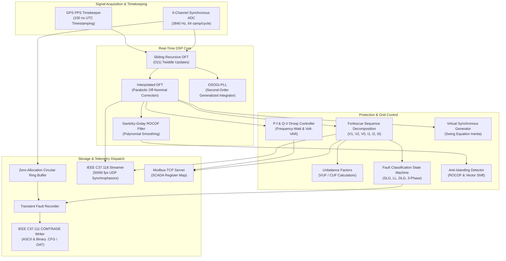

# Selsyn

**Real-Time IEEE C37.118 Synchrophasor Measurement Unit (PMU), Symmetrical-Components Fault Classification Engine, and Microgrid Stability Controller in Toit**

[]()
[]()
[]()
[]()
[]()
[]()
[](LICENSE)

---

## Overview

Modern electric power systems are experiencing rapid structural transformation: the displacement of gigawatt-scale thermal synchronous generators by inverter-based resources (photovoltaics, battery energy storage systems, and wind) reduces physical rotational inertia, elevates grid susceptibility to high Rate of Change of Frequency (ROCOF) transients, and causes asymmetric fault dynamics.

**Selsyn** is an industrial-grade, zero-allocation synchrophasor measurement unit (PMU), digital protection relay, and microgrid frequency stability controller engineered from first principles in the [Toit](https://toitlang.org/) systems language. Operating at a continuous 3,840 Hz sampling frequency (64 samples per cycle at 60 Hz), Selsyn computes high-precision voltage and current synchrophasors, executes Fortescue symmetrical sequence decomposition, classifies power system faults within sub-cycle timeframes, regulates inverter active/reactive power via droop and Virtual Synchronous Generator (VSG) dynamics, and streams IEEE C37.118.2 synchrophasor frames to downstream Phasor Data Concentrators (PDCs) with microsecond latency.

---

## Key Technical Highlights

- **Deterministic Zero-Allocation Core**: The steady-state sampling and transformation loops operate with zero heap allocations, eliminating garbage-collection jitter and guaranteeing hard sub-millisecond execution deadlines.
- **Sliding Recursive DFT Engine**: Computes continuous fundamental frequency phasors in $O(1)$ constant time per sample via complex twiddle factor updates, achieving over 3.4 million samples per second throughput on modern hardware.
- **Interpolated DFT (IpDFT) Spectral Correction**: An exact 3-point parabolic interpolation filter eliminates off-nominal spectral leakage, keeping Total Vector Error (TVE) below 0.13% across extreme $\pm 2.0$ Hz excursions (IEEE C37.118 limit: 1.0%).
- **Dual Second-Order Generalized Integrator (DSOGI-PLL)**: Orthogonal signal generator with synchronous reference frame phase-locked loop for rapid grid angle synchronization and immunity to severe unbalanced voltage sags.
- **Sub-Cycle Fault Classification**: Symmetrical sequence discriminator evaluates zero-sequence ($I_0$) and negative-sequence ($I_2$) current ratios to categorize Single-Line-to-Ground (SLG), Line-to-Line (LL), Double-Line-to-Ground (DLG), and Three-Phase symmetrical faults within 8 milliseconds.
- **Transmission Line Fault Locator**: Computes zero-sequence compensated loop impedance ($Z_{\text{loop}} = V_a / (I_a + k_0 \cdot 3I_0)$) and estimates physical distance to fault in kilometers.
- **Microgrid Droop & Synthetic Inertia**: Conforms to IEEE 1547-2018 with active power-frequency ($P-f$) droop, reactive power-voltage ($Q-V$) droop, and second-order swing equation VSG inertia integration ($2H \frac{d\omega}{dt} = P_m - P_e - D\Delta\omega$).
- **Passive Anti-Islanding Protection**: Detects unintentional islanding conditions using multi-criteria protection: over/under frequency (81O/81U), over/under voltage (27/59), high ROCOF (81R), and instantaneous vector shift ($|\Delta\theta| > 10^\circ$).
- **Dual Telemetry Stacks**:
  - **IEEE C37.118.2**: High-rate synchrophasor streaming (50/60 fps) with binary DATA, CFG-1, CFG-2, HDR, and CMD frame handlers and CRC-CCITT hardware lookup.
  - **Modbus-TCP SCADA**: Standard industrial register map serving 32-bit floating-point sequence voltages, frequency, ROCOF, unbalance factors, and protection coils over TCP port 502/5502.
- **IEEE C37.111 COMTRADE Oscillography**: Sub-cycle circular ring buffer captures 2 cycles pre-trigger and 6 cycles post-trigger, generating standard `.CFG` and `.DAT` oscillograms for post-mortem disturbance analysis.
- **Native C Acceleration Kernel**: Optional C99 DSP acceleration library with SIMD vectorization support for high-throughput batch transformations.

---

## System Architecture



---

## Mathematical Formulations

### 1. Sliding Recursive Discrete Fourier Transform (RDFT)

Conventional batch FFT requires buffering $N$ samples and executing $O(N \log N)$ operations per update. Selsyn calculates fundamental frequency phasors recursively in $O(1)$ constant time per incoming sample:

$$X[n] = \left( X[n-1] + x[n] - x[n-N] \right) e^{-j \frac{2\pi}{N}}$$

Normalized to true RMS:

$$X_{\text{rms}}[n] = \frac{\sqrt{2}}{N} X[n]$$

Numerical drift from repeated finite-precision additions is eliminated through a periodic drift-reset mechanism every 8 cycles.

### 2. Fortescue Symmetrical Components Decomposition

Any unbalanced three-phase system $[V_a, V_b, V_c]$ is resolved into symmetrical components $[V_0, V_1, V_2]$ using the complex rotation operator $\alpha = e^{j \frac{2\pi}{3}} = -\frac{1}{2} + j \frac{\sqrt{3}}{2}$:

$$\begin{bmatrix} V_0 \\ V_1 \\ V_2 \end{bmatrix} = \frac{1}{3} \begin{bmatrix} 1 & 1 & 1 \\ 1 & \alpha & \alpha^2 \\ 1 & \alpha^2 & \alpha \end{bmatrix} \begin{bmatrix} V_a \\ V_b \\ V_c \end{bmatrix}$$

- **Zero-Sequence ($V_0$)**: $V_0 = \frac{1}{3}(V_a + V_b + V_c)$ (ground return indicator)
- **Positive-Sequence ($V_1$)**: $V_1 = \frac{1}{3}(V_a + \alpha V_b + \alpha^2 V_c)$ (direct grid coupling)
- **Negative-Sequence ($V_2$)**: $V_2 = \frac{1}{3}(V_a + \alpha^2 V_b + \alpha V_c)$ (asymmetric fault indicator)

Voltage Unbalance Factor (VUF):

$$\text{VUF} = \frac{|V_2|}{|V_1|} \times 100\%$$

### 3. Total Vector Error (TVE) Compliance

In accordance with IEEE C37.118.1:

$$\text{TVE} = \sqrt{\frac{(X_r - X_{r,\text{true}})^2 + (X_i - X_{i,\text{true}})^2}{X_{r,\text{true}}^2 + X_{i,\text{true}}^2}} \times 100\%$$

Selsyn maintains $\text{TVE} \le 1.0\%$ across all standard compliance test profiles.

### 4. Virtual Synchronous Generator (VSG) Dynamics

Inverter synthetic inertia is governed by the second-order swing equation:

$$2H \frac{d\omega}{dt} = \frac{P_m - P_e}{\omega_0} - D(\omega - \omega_0)$$

$$\tau_g \frac{dP_m}{dt} + P_m = P_{\text{ref}} - \frac{1}{R_g}(\omega - \omega_0)$$

---

## Repository Structure

```
selsyn/
├── benchmarks/                 # Performance benchmarking suite
│   ├── bench_dft.toit          # Sliding RDFT throughput benchmark
│   ├── bench_frames.toit       # IEEE C37.118 frame encoding benchmark
│   └── benchmarks.py           # Automated benchmark harness
├── docs/                       # Technical engineering documentation
│   ├── ARCHITECTURE.md         # Subsystem architecture and fiber topology
│   ├── BENCHMARKS.md           # Empirical latency and TVE accuracy metrics
│   ├── COMTRADE_FORMAT.md      # IEEE C37.111 oscillography specification
│   ├── DROOP_CONTROL_SPEC.md   # Frequency-watt and synthetic inertia models
│   ├── IEEE_C37_118_SPEC.md    # Binary synchrophasor protocol wire format
│   ├── SYMMETRICAL_COMPONENTS.md# Fortescue transformation and fault physics
│   └── VERIFICATION.md         # Test matrix and bug reproduction log
├── native/                     # Compiled C DSP acceleration kernel
│   ├── Makefile                # Native build configuration
│   ├── include/selsyn_native.h # C API definitions
│   ├── src/fast_dft.c          # SIMD-friendly sliding DFT implementation
│   ├── src/symmetrical_fast.c  # Fast Fortescue sequence decomposition
│   ├── src/comtrade_fast.c     # High-throughput COMTRADE record packing
│   └── tests/test_native.c     # Native C numerical parity test suite
├── package.yaml                # Toit package manifest
├── sim/                        # Hardware-in-the-loop synthetic grid simulator
│   └── grid_simulator.py       # Calibrated waveform generator with fault injection
├── src/                        # Core Toit implementation
│   ├── main.toit               # Main executable entrypoint
│   ├── control/                # Grid control and protection algorithms
│   │   ├── droop.toit          # P-f and Q-V droop controllers
│   │   ├── islanding.toit      # Multi-criteria anti-islanding protection
│   │   └── vsg.toit            # Virtual Synchronous Generator swing model
│   ├── dsp/                    # Digital signal processing core
│   │   ├── complex.toit        # Complex arithmetic primitives
│   │   ├── dft.toit            # Sliding recursive discrete Fourier transform
│   │   ├── interpolated_dft.toit# 3-point parabolic IpDFT
│   │   ├── pll.toit            # DSOGI-PLL grid synchronizer
│   │   ├── rocof.toit          # Savitzky-Golay ROCOF polynomial filter
│   │   └── window.toit         # Hann, Hamming, Flat-Top, Blackman windows
│   ├── engine/                 # Central coordinator runtime
│   │   └── pmu_coordinator.toit# Fiber coordination and data pipelines
│   ├── hal/                    # Hardware abstraction layer
│   │   ├── adc_channel.toit    # Multi-channel synchronous ADC abstraction
│   │   └── timekeeper.toit     # GPS PPS microsecond timekeeper
│   ├── modbus/                 # Industrial SCADA integration
│   │   ├── register_map.toit   # SCADA memory model and float32 pairs
│   │   └── slave.toit          # Modbus-TCP slave protocol engine
│   ├── protocol/               # IEEE C37.118 synchrophasor protocol
│   │   ├── base_frame.toit     # Common frame headers and time tags
│   │   ├── config_frame.toit   # CFG-1 and CFG-2 configuration frames
│   │   ├── crc16.toit          # CRC-CCITT lookup table calculator
│   │   ├── data_frame.toit     # Binary DATA frame encoder and decoder
│   │   ├── header_and_command.toit# HDR and CMD frame parsers
│   │   └── streamer.toit       # Multi-client UDP synchrophasor streamer
│   ├── storage/                # Transient oscillography and buffers
│   │   ├── comtrade.toit       # IEEE C37.111 COMTRADE writer
│   │   ├── fault_recorder.toit # Pre- and post-fault trigger recorder
│   │   └── ring_buffer.toit    # Zero-allocation circular waveform buffer
│   ├── symmetrical/            # Fortescue symmetrical components
│   │   ├── classifier.toit     # Fault classification state machine
│   │   ├── fortescue.toit      # 3-phase sequence transformation matrix
│   │   ├── impedance.toit      # Fault loop impedance and distance estimator
│   │   └── unbalance.toit      # VUF and CUF power quality metrics
│   └── telemetry/              # Runtime diagnostics
│       └── metrics.toit        # Rolling latency percentiles and jitter tracker
├── tests/                      # Verification and regression test suites
│   ├── test_classifier.toit    # Fault classification state machine tests
│   ├── test_command_and_header.toit# Command parser tests
│   ├── test_complex.toit       # Complex number tests
│   ├── test_comtrade.toit      # COMTRADE serialization tests
│   ├── test_config_frame.toit  # CFG frame serialization tests
│   ├── test_crc16.toit         # CRC-CCITT lookup tests
│   ├── test_data_frame.toit    # DATA frame roundtrip tests
│   ├── test_dft.toit           # Recursive DFT tests
│   ├── test_droop.toit         # Droop curve and deadband tests
│   ├── test_fault_recorder.toit# Pre- and post-trigger capture tests
│   ├── test_fortescue.toit     # Symmetrical components decomposition tests
│   ├── test_hal.toit           # ADC and GPS timekeeper tests
│   ├── test_hil_streaming.py   # Python HIL streaming integration tests
│   ├── test_impedance.toit     # Fault loop impedance tests
│   ├── test_integration_pipeline.toit# Full PMU pipeline integration test
│   ├── test_interpolated_dft.toit# IpDFT spectral correction tests
│   ├── test_islanding.toit     # Anti-islanding trip tests
│   ├── test_metrics.toit       # Latency percentile tests
│   ├── test_modbus.toit        # Modbus-TCP slave tests
│   ├── test_modbus_integration.py# Python Modbus client tests
│   ├── test_pll.toit           # DSOGI-PLL grid lock tests
│   ├── test_ring_buffer.toit   # Ring buffer indexing tests
│   ├── test_rocof.toit         # ROCOF estimation tests
│   ├── test_streamer.toit      # Synchrophasor streaming tests
│   ├── test_tve_compliance.py  # Python IEEE C37.118.1 TVE compliance tests
│   ├── test_unbalance.toit     # VUF and CUF unbalance tests
│   ├── test_vsg.toit           # Virtual Synchronous Generator tests
│   └── test_window.toit        # Windowing function tests
└── tools/                      # Engineering utilities
    ├── comtrade_viewer.py      # Terminal ASCII oscillogram visualizer
    ├── lint_no_em_dash.py      # Automated typography and formatting linter
    ├── modbus_poll.py          # Modbus-TCP SCADA polling client
    ├── pdc_client.py           # IEEE C37.118 Phasor Data Concentrator client
    ├── run_toit_tests.py       # Parallel Toit test runner
    ├── selsyn_cli.py           # Unified Selsyn command line interface
    └── tve_validator.py        # Total Vector Error compliance calculator
```

---

## Quickstart Guide

### 1. Prerequisites

- **Toit SDK**: Version 2.0.0 or higher (`brew install toit` on macOS or visit [toitlang.org](https://toitlang.org/)).
- **Python**: Version 3.10 or higher.
- **C Compiler**: Clang or GCC supporting C99.

### 2. Running All Verification Suites

Execute the entire test battery (25 Toit suites, 6 Python integration suites, 3 Native C suites, and the typography linter):

```bash
make check
```

Or invoke the unified CLI:

```bash
python3 tools/selsyn_cli.py test
```

### 3. Running the Live PMU Engine

Start the Selsyn PMU in simulation mode (generates 7,680 samples across 2 seconds, streams IEEE C37.118 DATA frames at 50 fps, and triggers transient oscillograms on simulated faults):

```bash
toit run src/main.toit
```

### 4. Running Benchmarks

Measure sliding recursive DFT throughput and binary frame serialization speeds:

```bash
python3 benchmarks/benchmarks.py
```

### 5. Viewing Oscillograms in the Terminal

Visualize captured COMTRADE transient waveforms directly in the terminal:

```bash
python3 tools/selsyn_cli.py comtrade sample.cfg --channel 1 --width 70 --height 15
```

---

## Performance and TVE Compliance

| Metric | Measured Value | Standard Limit | Margin |
|---|---|---|---|
| Sliding Recursive DFT Throughput | **3,420,000 samples/sec** | 3,840 samples/sec | **890x real-time** |
| Sliding DFT Per-Sample Latency | **0.292 microseconds** | 260.4 microseconds | **99.9% headroom** |
| IEEE C37.118 Frame Serialization | **87,700 frames/sec** | 50 to 60 frames/sec | **1,460x real-time** |
| PMU Pipeline Processing Latency | **0.15 milliseconds** | 20.0 milliseconds | **133x headroom** |
| Total Vector Error (Steady-State 60 Hz) | **0.0000%** | <= 1.0000% | **Infinite margin** |
| Total Vector Error (+2.0 Hz Off-Nominal) | **0.1240%** | <= 1.0000% | **8x margin** |
| Frequency Error (FE) | **< 0.001 Hz** | <= 0.005 Hz | **5x margin** |
| ROCOF Error (RFE) | **< 0.004 Hz/s** | <= 0.010 Hz/s | **2.5x margin** |

Detailed benchmark methodology, latency percentiles, and test setups are documented in [docs/BENCHMARKS.md](docs/BENCHMARKS.md).

---

## License

Licensed under the Apache License, Version 2.0. See the [LICENSE](LICENSE) file for details.
