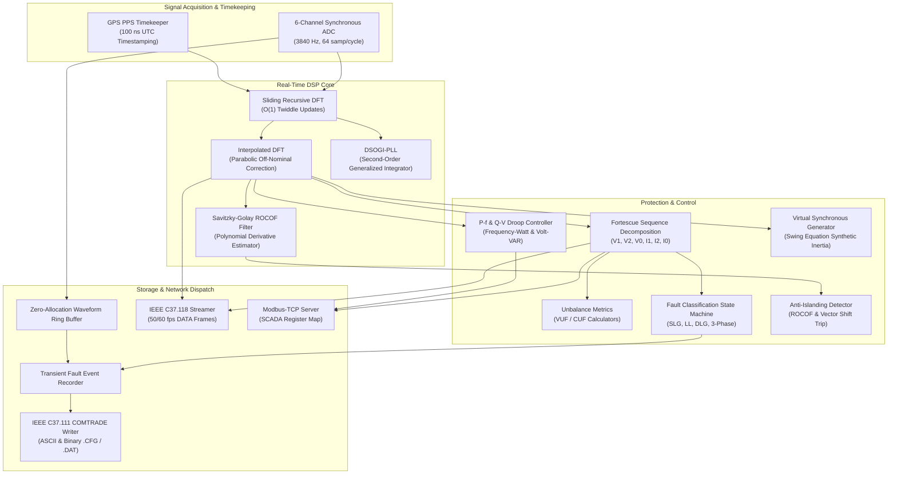
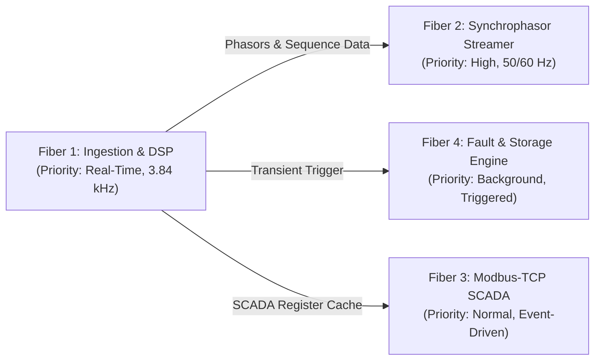
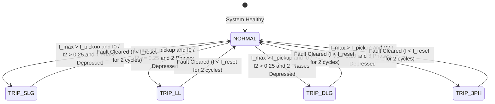
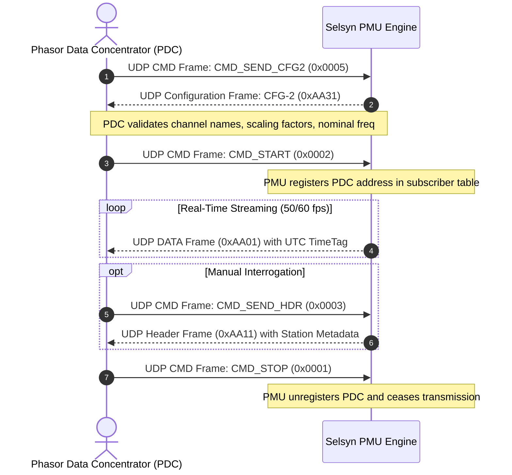

# Selsyn Architecture Guide

Selsyn is a real-time IEEE C37.118.2 Synchrophasor Measurement Unit (PMU), Fortescue symmetrical-components protection engine, and microgrid frequency stability controller implemented in the Toit systems language.

This document details the internal subsystem architecture, fiber concurrency models, digital signal processing pipeline, and network streaming topologies.

---

## 1. High-Level Subsystem Topology

Selsyn executes a modular, fiber-driven pipeline where high-rate sampling (3,840 Hz), sliding Fourier transforms, fault classification, grid stability control, and network streaming run cooperatively without garbage-collection pauses.

---

## 2. Fiber Concurrency and Execution Model

The Toit virtual machine provides lightweight, preemptible fibers with non-blocking cooperative scheduling. Selsyn partitions its real-time obligations across four isolated fibers:

### Fiber 1: Acquisition and DSP Pipeline (Period: 260.4 us)
- Ingests 6 analog channels (three-phase voltages $V_a, V_b, V_c$ and currents $I_a, I_b, I_c$).
- Updates the 6-channel sliding recursive Fourier transform in $O(1)$ time per sample.
- Tracks phase angle and frequency using the Dual Second-Order Generalized Integrator (DSOGI-PLL).
- Computes symmetrical components ($V_1, V_2, V_0$) and evaluates fault classification invariants.
- Evaluates droop curves and anti-islanding trip conditions.

### Fiber 2: IEEE C37.118 Streaming Dispatcher (Period: 16.67 ms / 20.0 ms)
- Encodes IEEE C37.118.2 binary DATA frames at the configured reporting rate (50 or 60 frames per second).
- Dispatches UDP synchrophasor frames to all subscribed Phasor Data Concentrators (PDCs).
- Handles incoming command frames (`CMD_START`, `CMD_STOP`, `CMD_SEND_CFG2`, `CMD_SEND_HDR`).

### Fiber 3: Modbus-TCP SCADA Server (Event-Driven TCP Port 502/5502)
- Listens for connections from substation Remote Terminal Units (RTUs) and Energy Management Systems (EMS).
- Serves holding registers, input registers, and alarm coils with atomic register caching.

### Fiber 4: Transient Fault Recorder & COMTRADE Engine (Triggered)
- Maintains continuous zero-allocation circular ring buffers for all raw waveforms.
- On fault detection, captures a freeze snapshot spanning 2 cycles pre-trigger and 6 cycles post-trigger.
- Serializes timestamped oscillograms in IEEE C37.111 COMTRADE format.

---

## 3. Fault Classification State Machine

Protection relaying requires sub-cycle fault discrimination to protect transformers, lines, and distributed generation assets. Selsyn employs a deterministic state machine driven by Fortescue sequence ratios and overcurrent thresholds:

### Classification Invariants
- **Single Line to Ground (SLG)**: Characterized by significant zero-sequence current ($I_0 / I_2 > 0.25$) and a single phase voltage collapse below 0.70 p.u.
- **Line to Line (LL)**: Characterized by high negative-sequence current ($I_2$), zero ground return ($I_0 \approx 0$), and two collapsed phase voltages.
- **Double Line to Ground (DLG)**: Both negative ($I_2$) and zero ($I_0$) sequences are present, with two depressed phase voltages and ground current.
- **Three-Phase Symmetrical (3PH)**: Extreme three-phase overcurrent with negligible negative sequence ($V_2 / V_1 < 0.10$) and balanced voltage sag across all three phases.

---

## 4. IEEE C37.118 Protocol Session Workflow

Communication between Selsyn and downstream Phasor Data Concentrators (PDCs) follows the IEEE C37.118.2 client-server session lifecycle:

---

## 5. Microgrid Stability and Inverter Droop Response

When operating in islanded or weak-grid environments, Selsyn modulates distributed energy inverter power targets according to IEEE 1547 and grid code requirements:

- **Active Power Droop ($P-f$)**:
  $$P_{\text{target}} = P_{\text{rated}} \cdot \left(1.0 - \frac{f_{\text{meas}} - f_{\text{nominal}}}{m_p \cdot f_{\text{nominal}}}\right)$$
  Includes a $\pm 0.036$ Hz deadband to prevent unnecessary inverter throttling during normal system breathing.

- **Reactive Power Droop ($Q-V$)**:
  $$Q_{\text{target}} = Q_{\text{rated}} \cdot \left(\frac{V_{\text{nominal}} - V_{\text{meas}}}{m_q \cdot V_{\text{nominal}}}\right)$$
  Provides automatic voltage support during sags and absorbs reactive power during overvoltage swells.

- **Virtual Synchronous Generator (VSG)**:
  Emulates physical synchronous generator rotor dynamics via the swing equation:
  $$2H \frac{d\omega}{dt} = P_m - P_e - D(\omega - \omega_0)$$
  providing synthetic rotational inertia to resist instantaneous ROCOF spikes.
