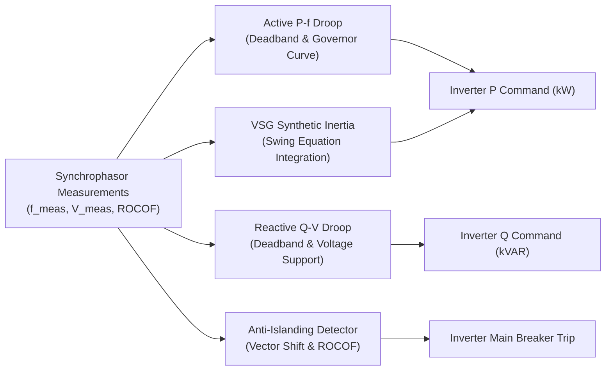

# Microgrid Droop Control and Grid Stability Specification

This document details the control algorithms, droop curves, synthetic inertia dynamics, and anti-islanding protection schemes implemented in Selsyn for distributed energy resources (DERs) and microgrid controllers.

---

## 1. Grid-Forming and Droop Control Concepts

In modern inverter-dominated power grids, distributed energy systems (such as battery energy storage systems, photovoltaic inverters, and wind generators) must participate in autonomous frequency and voltage regulation without centralized supervisory control.

Selsyn implements decentralized primary frequency and voltage control via active power-frequency ($P-f$) and reactive power-voltage ($Q-V$) droop characteristics conforming to IEEE 1547-2018.

---

## 2. Active Power-Frequency ($P-f$) Droop

The frequency droop curve dynamically adjusts active power output in response to grid frequency deviations.

### 2.1 Mathematical Formulation

Let $f_0$ be the nominal grid frequency (60.0 Hz or 50.0 Hz), $f_{\text{meas}}$ the estimated frequency from IpDFT/PLL, and $P_{\text{rated}}$ the nominal inverter power rating.

$$\Delta f = f_{\text{meas}} - f_0$$

To prevent continuous control oscillation during minor frequency breathing, a symmetric deadband $f_{\text{db}}$ (default: $0.036\text{ Hz}$) is enforced:

$$\Delta f_{\text{eff}} = \begin{cases} 
0, & |\Delta f| \le f_{\text{db}} \\
\Delta f - f_{\text{db}}, & \Delta f > f_{\text{db}} \\
\Delta f + f_{\text{db}}, & \Delta f < -f_{\text{db}}
\end{cases}$$

The target active power output is then:

$$P_{\text{target}} = P_{\text{rated}} \cdot \left( 1.0 - \frac{\Delta f_{\text{eff}}}{m_p \cdot f_0} \right)$$

where $m_p$ is the dimensionless droop percentage (typically $3.0\%$ to $5.0\%$, default: $0.05$).

### 2.2 Saturation Limits

Power output is strictly clamped to physical inverter thermal capabilities:

$$0 \le P_{\text{min}} \le P_{\text{target}} \le P_{\text{max}}$$

---

## 3. Reactive Power-Voltage ($Q-V$) Droop

The voltage droop curve modulates reactive power injection or absorption to stabilize local bus voltage:

### 3.1 Mathematical Formulation

Let $V_0$ be nominal bus voltage (120.0 V or 1.0 p.u.), $V_{\text{meas}}$ positive-sequence voltage magnitude, and $Q_{\text{rated}}$ reactive power capacity.

$$\Delta V = V_0 - V_{\text{meas}}$$

With voltage deadband $V_{\text{db}}$ (default: $0.02\text{ p.u.}$ or $2.4\text{ V}$):

$$\Delta V_{\text{eff}} = \begin{cases}
0, & |\Delta V| \le V_{\text{db}} \\
\Delta V - V_{\text{db}}, & \Delta V > V_{\text{db}} \quad (\text{Voltage Sag: Inject Capacitive } Q) \\
\Delta V + V_{\text{db}}, & \Delta V < -V_{\text{db}} \quad (\text{Voltage Swell: Absorb Inductive } Q)
\end{cases}$$

The target reactive power is:

$$Q_{\text{target}} = Q_{\text{rated}} \cdot \left( \frac{\Delta V_{\text{eff}}}{m_q \cdot V_0} \right)$$

clamped between $[-Q_{\text{max}}, +Q_{\text{max}}]$.

---

## 4. Virtual Synchronous Generator (VSG) Dynamics

Physical synchronous generators inherently oppose rapid frequency changes through the kinetic energy stored in their rotating rotors. To replicate this stabilizing property in inverter-based microgrids, Selsyn implements the standard second-order swing equation:

$$2H \frac{d\omega_{\text{vsg}}}{dt} = \frac{P_m - P_e}{\omega_0} - D(\omega_{\text{vsg}} - \omega_0)$$

where:
- $H$: Synthetic inertia constant in seconds (typically $2.0$ to $6.0\text{ s}$).
- $D$: Damping factor ($\text{MW} \cdot \text{s} / \text{rad}$).
- $P_m$: Virtual mechanical prime mover power.
- $P_e$: Electrical measured active power.
- $\omega_{\text{vsg}}$: Virtual rotor angular frequency ($\text{rad/s}$).
- $\omega_0$: Base synchronous frequency ($2\pi \cdot 60.0\text{ rad/s}$).

### 4.1 Governor Response

The virtual prime mover $P_m$ adjusts dynamically through a first-order governor transfer function with time constant $\tau_g$:

$$\tau_g \frac{dP_m}{dt} + P_m = P_{\text{set}} - \frac{1}{R_g} (\omega_{\text{vsg}} - \omega_0)$$

This synthetic inertia dramatically reduces the initial Rate of Change of Frequency (ROCOF) following sudden generation-load imbalances.

---

## 5. Passive Anti-Islanding Detection

Unintentional islanding occurs when a portion of the distribution grid disconnects from the main utility while remaining energized by local DERs. This poses safety hazards to utility line crews and out-of-phase reclosing risks.

Selsyn monitors multiple independent passive criteria:

| Protection Function | ANSI Code | Threshold | Trip Time |
|---|---|---|---|
| Over-Frequency | 81O | $f > 62.0\text{ Hz}$ | $160\text{ ms}$ (8 cycles) |
| Under-Frequency | 81U | $f < 58.0\text{ Hz}$ | $160\text{ ms}$ (8 cycles) |
| Over-Voltage | 59 | $V > 1.20\text{ p.u.}$ | $160\text{ ms}$ (8 cycles) |
| Under-Voltage | 27 | $V < 0.80\text{ p.u.}$ | $160\text{ ms}$ (8 cycles) |
| High ROCOF | 81R | $|\text{ROCOF}| > 2.0\text{ Hz/s}$ | $100\text{ ms}$ (5 cycles) |
| Vector Shift | VS | $|\Delta \theta_{\text{instant}}| > 10.0^\circ$ | Sub-cycle ($16\text{ ms}$) |

### 5.1 Vector Shift Detection

When the utility breaker opens, the sudden load shift causes an instantaneous phase step jump in the measured voltage waveform. Selsyn calculates:

$$\Delta \theta_k = (\theta_k - \theta_{k-1}) - \omega_0 \Delta t$$

If $|\Delta \theta_k| > \theta_{\text{threshold}}$ (typically $10^\circ$), the anti-islanding trip coil is asserted immediately.
