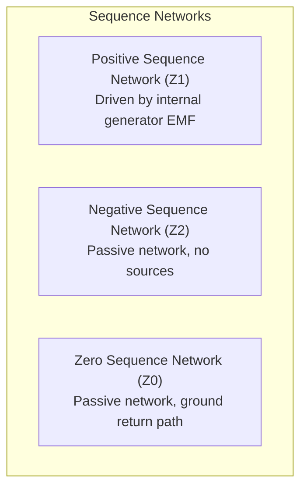

# Symmetrical Components and Fault Classification Theory

This document details the mathematical foundations of Fortescue's symmetrical components transformation, sequence network models, unbalance metrics, and the fault discrimination physics implemented in Selsyn.

---

## 1. Fortescue Symmetrical Components Transformation

In 1918, Charles LeGeyt Fortescue proved that any arbitrary unbalanced set of $N$ symmetrical phasors can be uniquely decomposed into $N$ symmetrical components. For three-phase power systems ($N=3$), any unbalanced three-phase voltage or current vector is resolved into three symmetrical sequence components:

1. **Positive-Sequence ($V_1$)**: Balanced phasors of equal magnitude, displaced by $120^\circ$, with positive phase rotation sequence ($A-B-C$).
2. **Negative-Sequence ($V_2$)**: Balanced phasors of equal magnitude, displaced by $120^\circ$, with reversed phase rotation sequence ($A-C-B$).
3. **Zero-Sequence ($V_0$)**: Phasors of equal magnitude and identical phase angle (in phase with each other), representing ground return currents.

### 1.1 The Complex Rotation Operator $\alpha$

Define the unit complex phasor advance operator $\alpha$:

$$\alpha = e^{j \frac{2\pi}{3}} = \cos\left(\frac{2\pi}{3}\right) + j \sin\left(\frac{2\pi}{3}\right) = -\frac{1}{2} + j \frac{\sqrt{3}}{2} \approx -0.5000 + j 0.8660$$

$$\alpha^2 = e^{j \frac{4\pi}{3}} = -\frac{1}{2} - j \frac{\sqrt{3}}{2} \approx -0.5000 - j 0.8660$$

$$\alpha^3 = 1.0, \quad 1 + \alpha + \alpha^2 = 0$$

### 1.2 Matrix Formulation

The phase voltages $[V_{abc}]$ and sequence voltages $[V_{012}]$ are related by the Fortescue transformation matrix $A$:

$$\begin{bmatrix} V_a \\ V_b \\ V_c \end{bmatrix} = \begin{bmatrix} 1 & 1 & 1 \\ 1 & \alpha^2 & \alpha \\ 1 & \alpha & \alpha^2 \end{bmatrix} \begin{bmatrix} V_0 \\ V_1 \\ V_2 \end{bmatrix}$$

Inverting matrix $A$ yields the decomposition equations:

$$\begin{bmatrix} V_0 \\ V_1 \\ V_2 \end{bmatrix} = \frac{1}{3} \begin{bmatrix} 1 & 1 & 1 \\ 1 & \alpha & \alpha^2 \\ 1 & \alpha^2 & \alpha \end{bmatrix} \begin{bmatrix} V_a \\ V_b \\ V_c \end{bmatrix}$$

Explicitly:
- **Zero Sequence**:
  $$V_0 = \frac{1}{3} (V_a + V_b + V_c)$$
- **Positive Sequence**:
  $$V_1 = \frac{1}{3} (V_a + \alpha V_b + \alpha^2 V_c)$$
- **Negative Sequence**:
  $$V_2 = \frac{1}{3} (V_a + \alpha^2 V_b + \alpha V_c)$$

The exact same linear transformation applies to the three-phase currents $[I_a, I_b, I_c]$ to produce $[I_0, I_1, I_2]$.

---

## 2. Voltage and Current Unbalance Metrics

Power system unbalance induces parasitic heating in induction machines, degrades power quality, and causes zero-sequence neutral currents. Selsyn calculates the standard international metrics:

### 2.1 Voltage Unbalance Factor (VUF)

According to IEC 61000-4-30 and IEEE standards:

$$\text{VUF} = \frac{|V_2|}{|V_1|} \times 100\%$$

In healthy transmission and distribution networks, VUF is typically kept below $1.0\%$ to $2.0\%$.

### 2.2 Current Unbalance Factor (CUF)

$$\text{CUF} = \frac{|I_2|}{|I_1|} \times 100\%$$

High CUF indicates asymmetric loading, phase open conductors, or unbalanced grid impedance.

---

## 3. Sequence Network Fault Signatures

Different physical faults impose characteristic boundary conditions on the three sequence networks:

### 3.1 Single Line-to-Ground Fault (SLG on Phase A)
- **Boundary Condition**: $I_b = 0, \quad I_c = 0, \quad V_a = I_a Z_f$
- **Sequence Interconnection**: The positive, negative, and zero sequence networks are connected in **series**:
  $$I_1 = I_2 = I_0 = \frac{E_a}{Z_1 + Z_2 + Z_0 + 3Z_f}$$
- **Identification Invariant**: High zero-sequence current ($I_0 / I_2 > 0.25$) and a single phase voltage sag.

### 3.2 Line-to-Line Fault (LL between Phase B and C)
- **Boundary Condition**: $I_a = 0, \quad I_b = -I_c, \quad V_b - V_c = I_b Z_f$
- **Sequence Interconnection**: The positive and negative sequence networks are connected in **parallel**; zero-sequence network is isolated:
  $$I_1 = -I_2, \quad I_0 = 0$$
- **Identification Invariant**: Strong negative sequence ($I_2$), zero ground return ($I_0 \approx 0$), and two depressed phase voltages ($V_b, V_c$).

### 3.3 Double Line-to-Ground Fault (DLG on Phases B and C)
- **Boundary Condition**: $I_a = 0, \quad V_b = V_c = (I_b + I_c) Z_f$
- **Sequence Interconnection**: All three sequence networks (positive, negative, and zero) are connected in **parallel**:
  $$I_1 + I_2 + I_0 = 0$$
- **Identification Invariant**: Significant negative sequence ($I_2$) AND zero sequence ($I_0$) present simultaneously, with two phase voltages depressed.

### 3.4 Symmetrical Three-Phase Fault (3PH)
- **Boundary Condition**: $V_a + V_b + V_c = 0, \quad I_a + I_b + I_c = 0$
- **Sequence Interconnection**: Only the positive-sequence network is loaded; negative and zero sequence networks remain unexcited:
  $$V_2 \approx 0, \quad V_0 \approx 0, \quad I_2 \approx 0, \quad I_0 \approx 0$$
- **Identification Invariant**: Extreme symmetrical overcurrent across all three phases with $|V_2| / |V_1| < 0.10$.

---

## 4. Fault Loop Impedance and Distance Estimation

To locate transmission line faults, Selsyn implements zero-sequence compensated loop impedance calculations:

### 4.1 Ground Fault Loop Impedance (Phase A to Ground)

$$Z_{\text{loop}} = \frac{V_a}{I_a + k_0 \cdot (3 I_0)}$$

where $k_0$ is the zero-sequence current compensation factor:

$$k_0 = \frac{Z_0 - Z_1}{3 Z_1}$$

This accounts for the mutual ground return path impedance difference between line conductors and earth.

### 4.2 Phase-to-Phase Fault Loop Impedance (Phase B to Phase C)

$$Z_{\text{loop}} = \frac{V_b - V_c}{I_b - I_c}$$

The resulting positive-sequence loop reactance $X_{\text{loop}} = \text{Im}(Z_{\text{loop}})$ is linearly proportional to the physical distance $d$ from the PMU terminal to the fault inception point:

$$d = \frac{X_{\text{loop}}}{x_{\text{line}}} \text{ km}$$
